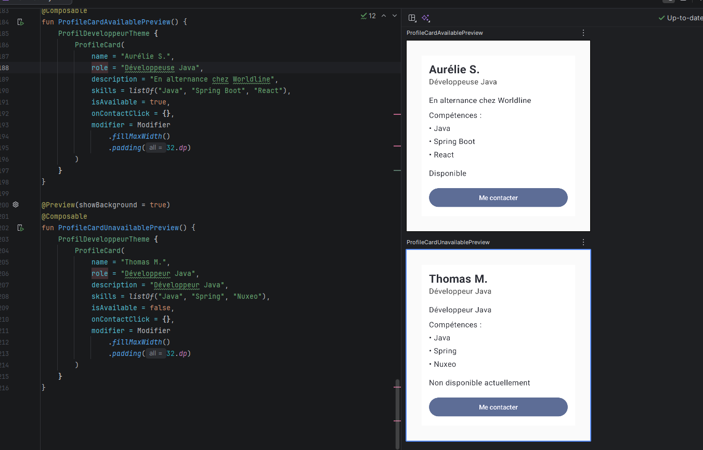

# Profil développeur Compose

Écran Jetpack Compose affichant une fiche développeur : nom, rôle, description, compétences, disponibilité et bouton « Me contacter ».

**Notions** : composables, paramètres, modifiers, padding externe/interne, callbacks, previews, accessibilité.

1. **Composables** : ProfileScreen, ProfileCard, ProfileCardContent, ProfileHeader, SkillItem, Availability, ContactButton
2. **Écran principal** : ProfileScreen
3. **Padding externe** : `padding(32.dp)` passé par ProfileScreen à ProfileCard (zone grise)
4. **Padding interne** : `padding(16.dp)` sur la Column de ProfileCardContent (dans la carte blanche)
5. **Callback** : ContactButton reçoit `onContactClick`
6. **Accessibilité** : utilisation d'un `Button`, qui expose déjà son rôle de bouton et son texte aux lecteurs d'écran, contrairement à une zone cliquable personnalisée
7. **Réutilisables** : données et modifier passés en paramètres ; 2 previews affichent 2 profils différents

